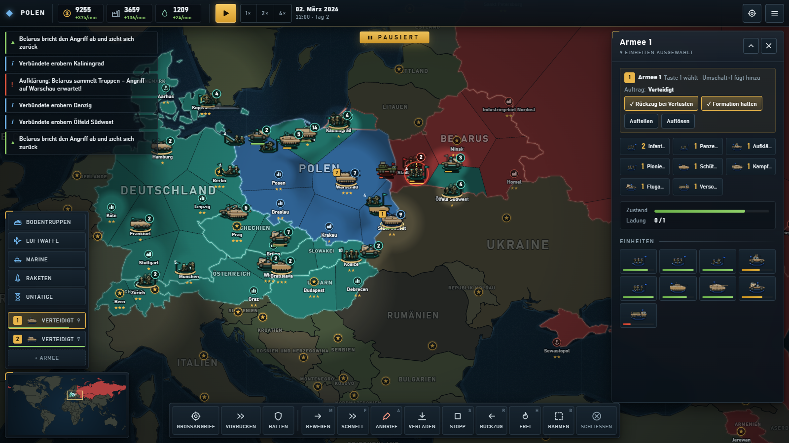

# IRON MERIDIAN – Globaler Konflikt 2026 (Beta 1.1)

Globales Echtzeit-Strategiespiel mit Pause für Einzelspieler gegen KI. Weltkarte mit allen Ländern, Provinzen mit Städten,
Industriegebieten, Ölfeldern, Häfen und Luftwaffenbasen, moderne Einheiten (2000–2026) zu Land, Luft und See sowie Raketen.
Geführt wird nicht Einheit für Einheit, sondern mit **Armeen aus Kampfgruppen**, die Befehle wie „Großangriff“ selbst in
Phasen ausführen.

## ▶ Jetzt spielen (Handy & Browser)
**https://papoch295.github.io/ironmeridian/**

Einfach auf dem Handy öffnen, am besten im Querformat. Über „Zum Startbildschirm hinzufügen“ (Android: Chrome-Menü,
iPhone: Safari → Teilen) lässt es sich wie eine App starten. Nach dem ersten Öffnen läuft es auch offline.
Für den Einstieg im Hauptmenü **Tutorial** wählen (12 kurze Schritte direkt an den echten Knöpfen).
Ausführlich: **[Spielanleitung](SPIELANLEITUNG.md)** mit Screenshots · [Quellen und Lizenzen](QUELLEN.md) ·
[Testprotokoll](TESTPROTOKOLL.md) · [Änderungsprotokoll](CHANGELOG.md)



## Spielmodi und Spielziel
- **Freie Länderwahl:** Jedes Land der Welt ist spielbar (außer Zwergstaaten wie dem Vatikan). Jedes Land ist eine eigene
  Fraktion mit eigener Wirtschaft und KI; Bündnisse kämpfen als Team, Verbündete werden von der KI geführt.
- **Bündniskrieg:** Dein Bündnis gegen ein gewähltes feindliches Bündnis. Alle anderen Länder bleiben neutral.
- **Weltkrieg:** Jeder gegen jeden – alle Bündnisse kämpfen gegeneinander, Länder ohne Bündnis bleiben zunächst neutral.
- **Neutrale Länder** lassen sich per Kriegserklärung angreifen; sie machen dann mobil, und ihre Nachbarn reagieren.
- **Schwierigkeit** Leicht / Normal / Schwer bestimmt unter anderem, wie oft die KI-Offensiven kommen (alle 8 / 6 / 4 Spielminuten).

**Sieg:** Jede Provinz bringt Siegpunkte (Hauptstadt 5, Stadt/Hafen/Industrie/Ölfeld 2, Luftwaffenbasis 1). Halten du und
deine Verbündeten **70 % der feindlichen Siegpunkte eine Spielminute lang**, kapituliert der Gegner (Punktesieg). Der
Countdown erscheint als Banner; das Ziele-Fenster zeigt den Fortschritt. Wer alles erobert, gewinnt sofort.
**Im Weltkrieg** gilt stattdessen der **Weltmacht-Sieg**: Dein Bündnis muss **25 % aller Siegpunkte der Welt** eine
Spielminute lang halten (zu Beginn hält jedes Bündnis höchstens etwa 5 %).
**Niederlage:** Hält der Feind mehr als 70 % der Siegpunkte deines Heimatlands eine Minute lang, kapituliert dein Land.

## Spielprinzip
- **Wirtschaft:** Geld, Industrie und Öl aus Provinzen; Provinzen lassen sich bis Stufe 5 ausbauen. Institutionen:
  Kaserne, Rüstungswerk, Flugplatz, Werft, Raketenbasis, Radarstation, Flugabwehrstellung, Forschungszentrum.
- **Unterhalt:** Jede Einheit kostet laufend Geld und Öl. Masse lohnt sich nicht, ausgewogene Verbände schon.
- **Kampfgruppen und Armeen:** Infanterie-, Mech.- und Panzer-Kampfgruppen, Artilleriebatterie und Luftlandezug werden mit
  einem Tippen rekrutiert. Armee-Befehle: **Großangriff** (Anmarsch → Aufklärung → Artillerie → Sturm → Halten),
  **Vorrücken**, **Halten**, schaltbarer **Rückzug bei Verlusten**. Flak, Sanitäter und Versorgung folgen selbst.
- **Taktik:** Sichtweite und Nebel des Krieges, Radar, Niederhalten durch Beschuss, **Eingraben** (bis −40 % Schaden nach
  längerem Stillstand), Nachschub, Reparatur, Transport über See und Luft, Raketen bis hin zu Atomwaffen mit Fallout.
- **Luftwaffe und Raketen:** Das Luftwaffen-Fenster zeigt alle Flugzeuge und Hubschrauber im Land mit Status und Treibstoff.
  Im **Dauereinsatz** greifen Flugzeuge ein Gebiet an, tanken auf und kehren von selbst zurück. Das Raketen-Fenster zeigt den
  Vorrat aller Basen und U-Boote; die nächste Basis in Reichweite feuert automatisch. Beim Zielen zeigen Kreise die Reichweite.
- **KI:** Greift in festen Offensiven an (erst Truppen sammeln, dann gemeinsamer Angriff entlang einer Hauptachse) und nutzt
  dieselbe Kampfgruppen-Taktik wie der Spieler, inklusive Rückzug. Aufklärung warnt rechtzeitig vor dem Truppensammeln.
- **34 Einheitentypen** mit eigenen Modellen für West und Ost, Deutsch und Englisch, Touch- und Maussteuerung –
  darunter Aufklärungs- und Kamikaze-Drohnen, Patriot / S-400 als Raketenabwehr und ein Landungsschiff für Landungen
  an jeder Küste.

## Spielstände
Beliebig viele benannte Spielstände plus drei rotierende Autosaves (alle 2 Spielminuten, beim Start, beim Kriegsende und wenn
das Spiel in den Hintergrund geht). Gespeichert wird in IndexedDB (gzip-komprimiert), die Liste im localStorage. Spielstände
lassen sich löschen, werden nach Updates automatisch umgewandelt und enthalten Fingerabdrücke der Provinzen, damit sie auch
nach Kartenänderungen ladbar bleiben. Stürzt das Spiel ab, wird es angehalten und ein Notfall-Spielstand angelegt.

## Starten (Entwicklung)
- **Desktop:** Verknüpfung „Iron Meridian“ auf dem Desktop (öffnet das Spiel als App-Fenster in Microsoft Edge).
- **Entwicklung:** `node tools/serve.js 8765` und dann `http://127.0.0.1:8765` öffnen. `index.html` läuft auch direkt per Doppelklick.
- **Neu installieren nach Änderungen:** `powershell -ExecutionPolicy Bypass -File tools\install-desktop.ps1`
  (kopiert das Spiel nach `Dokumente\IronMeridian` und erneuert die Verknüpfung).
- **Web-Version:** Jeder Push auf `main` aktualisiert GitHub Pages. Der Service Worker (`sw.js`) lädt zuerst aus dem Netz und
  fällt offline auf den Cache zurück; neue oder umbenannte Dateien in `FILES` eintragen und `CACHE` hochzählen.

## Testen
- **Automatischer Testlauf:** `node tools/selftest.js [Partien=3] [Spielminuten=20]` öffnet das Spiel unsichtbar in Edge/Chrome
  (über `file://`, wie die Desktop-Installation), spielt mehrere Partien KI gegen untätigen Spieler im Zeitraffer und prüft
  Fehler, kaputte Werte, Speichern/Laden, Punktesieg und Kapitulation sowie den Offline-Cache. Exit-Code 0 = alles in Ordnung.
- Im Browser: `index.html?selftest=3&min=20` zeigt dasselbe Ergebnis unten links an.
- **Modell-Galerie:** `tools/gallery.html?only=land` (bzw. `air`, `sea` oder einzelne Typen wie `only=mbt,ifv&sz=90`).
- **Screenshots für die Doku:** `node tools/screenshots.js` stellt sieben Szenen nach und speichert sie als PNG in
  `docs/screenshots/`.

## Technik
- Reines HTML5 / CSS / JavaScript (Canvas 2D), keine Abhängigkeiten, kein Build-Schritt, läuft offline und per `file://`
  (deshalb klassische `<script>`-Dateien statt ES-Module; Reihenfolge in `index.html`).
- Kartendaten: Natural Earth (gemeinfrei) über `world-atlas@2.0.2`, umgewandelt mit `tools/build-world.js`
  (`js/data/world.js` ist generiert und wird nicht von Hand geändert).
- Sound wird zur Laufzeit erzeugt (Web Audio), keine fremden Audiodateien. Alle Grafiken sind eigene Canvas-Zeichnungen.

| Datei / Ordner | Inhalt |
|---|---|
| `js/data` | Weltkarte (generiert), Städte & Bündnisse (`scenario.js`), Einheiten / Waffen / Gebäude / Balance-Werte (`units.js`) |
| `js/core/game.js` | Spielzustand, Fraktionen, Bündnisse, Wirtschaft, Schwierigkeit |
| `js/core/sim.js` | Simulation: Bewegung, Kampf, Sicht, Eroberung, Siegbedingungen |
| `js/core/tactics.js` | Kampfgruppen-Taktik für KI und Spieler-Armeen (Phasen, Rollen, Rückzug) |
| `js/core/ai.js` | Gegner-KI: Wirtschaft, Offensiven, Verteidigung, Luftwaffe, Marine, Raketen |
| `js/core/geo.js`, `path.js` | Geometrie & Provinzen, Wegfindung (A*) |
| `js/render` | Karten-Renderer, NATO-Symbole, Modelle (Infanterie, Land West/Ost, Luft, See) |
| `js/ui` | HUD, Seitenfenster, Menüs, Tutorial, Eingabe (Maus, Touch, Tastatur) |
| `js/save.js`, `crash.js` | Spielstände (IndexedDB, Migration), Fehlerfang mit Notfall-Spielstand |
| `js/i18n.js` | Alle Texte auf Deutsch und Englisch |
| `sw.js`, `manifest.webmanifest` | Offline-Cache und Installation als Web-App |
| `tools/` | Entwicklungsserver, Selbsttest, Karten-Generator, Modell-Galerie, Desktop-Installation |

## Android-Port
Weil das Spiel eine reine Web-App ohne Server ist, lässt es sich mit **Capacitor** ohne Code-Änderungen als Android-App verpacken
(geplant für Beta 2, Details in `ROADMAP.md` Abschnitt 6):
```
npm init -y
npm install @capacitor/core @capacitor/cli @capacitor/android
npx cap init "Iron Meridian" com.ironmeridian.game --web-dir .
npx cap add android
npx cap open android
```
Touch-Steuerung (Tippen, Ziehen, Pinch-Zoom, Auswahlrahmen per langem Druck) und das Layout für Hoch- und Querformat sind bereits eingebaut,
auch für niedrige Querformat-Bildschirme mit sichtbarer Browserleiste. Für flüssiges Verschieben und Zoomen wird die Karte während
der Bewegung nur verschoben und erst im Stillstand neu gezeichnet; Touch-Geräte zeichnen mit 1,5-facher statt 2-facher Auflösung.

## Bekannte Grenzen der Beta
- Die Karte wiederholt sich nicht über die Datumsgrenze.
- Bodentruppen betreten neutrale Länder erst nach einer Kriegserklärung; Luftwaffe und Marine dürfen sie überqueren.
- Balancing ist auf „Leicht“ und „Normal“ abgestimmt; „Schwer“ wird in späteren Versionen verfeinert.
- Noch nicht enthalten (geplant ab Beta 2): Diplomatie, Technologiebaum, Eskalation, Szenarien mit Briefing, Musik, Android-App.
- **Weitere Einheiten in Planung** (`ROADMAP.md` Abschnitt 3.1): u. a. Erdkampfflugzeug, Fregatte, EloKa-Fahrzeug,
  Gefechtsstand und Marineinfanterie.

Weitere Planung: [`ROADMAP.md`](ROADMAP.md).
