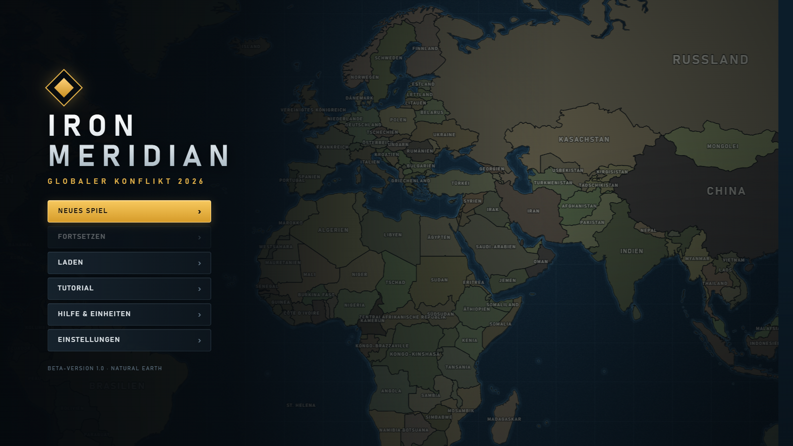
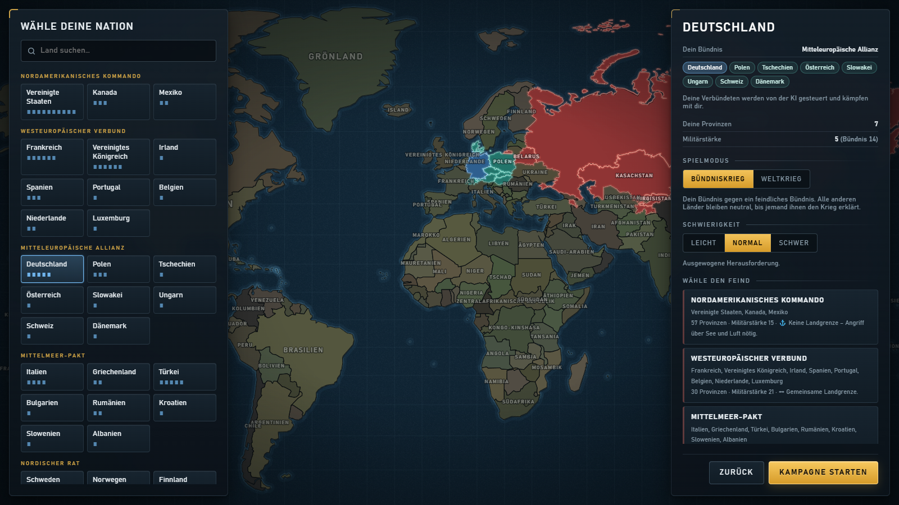
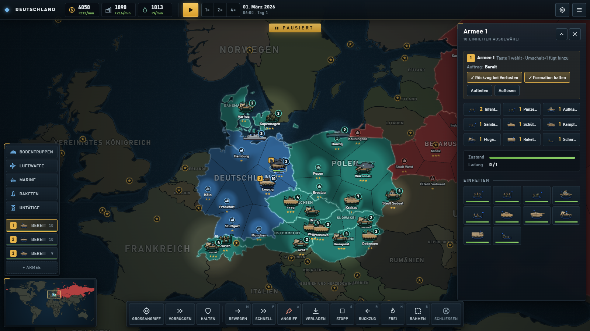
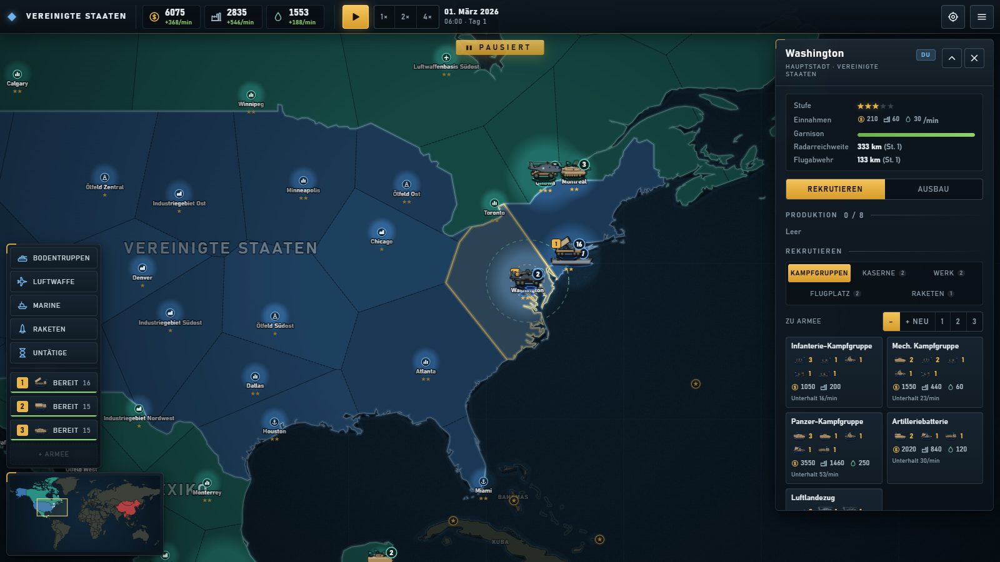
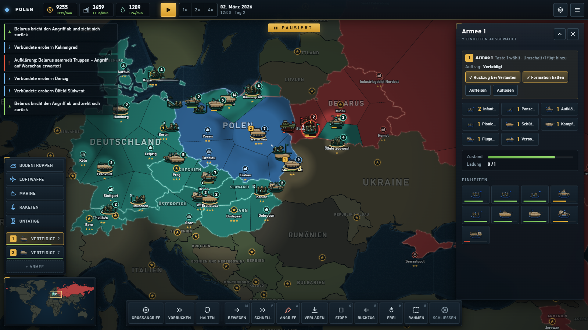
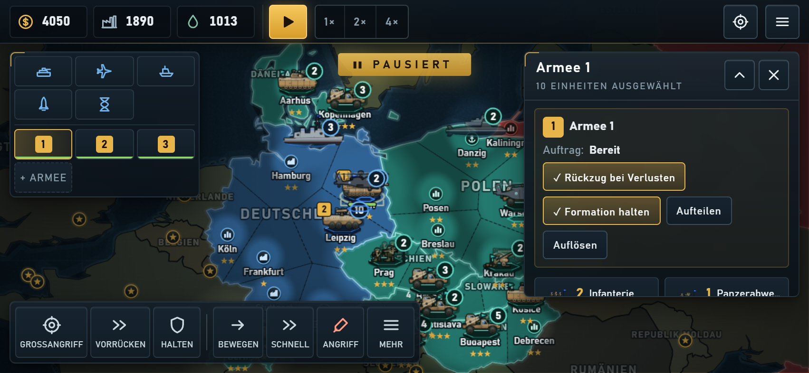
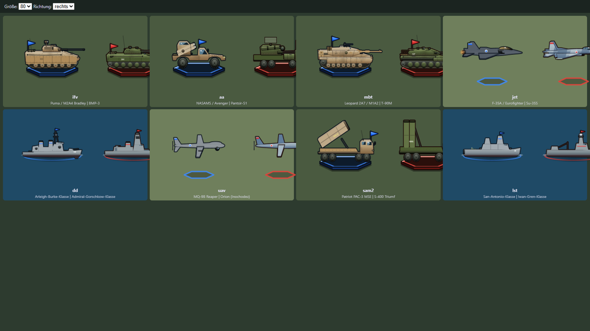

# Iron Meridian – Spielanleitung

**Iron Meridian – Globaler Konflikt 2026** ist ein Echtzeit-Strategiespiel mit Pause. Du führst ein Land deiner Wahl durch
einen modernen Krieg gegen computergesteuerte Gegner: Wirtschaft aufbauen, Truppen rekrutieren, Armeen führen und
Provinzen erobern, bis der Gegner kapituliert.

**Spielen:** https://papoch295.github.io/ironmeridian/ im Browser (Handy am besten im Querformat). Nach dem ersten
Öffnen läuft das Spiel auch offline. Über „Zum Startbildschirm hinzufügen“ startet es wie eine App.

> Für den Einstieg im Hauptmenü **Tutorial** wählen: 12 kurze Schritte direkt an den echten Knöpfen.

---

## 1. Eine Partie beginnen

Unter **Neues Spiel** wählst du:

- **Dein Land:** jedes Land der Welt (außer Zwergstaaten wie dem Vatikan). Länder mit Bündnis kämpfen gemeinsam mit
  ihren Verbündeten, die von der KI geführt werden.
- **Modus:**
  - **Bündniskrieg:** dein Bündnis gegen ein feindliches Bündnis, alle anderen bleiben neutral.
  - **Weltkrieg:** jeder gegen jeden, alle Bündnisse kämpfen gegeneinander.
- **Schwierigkeit:** Leicht, Normal oder Schwer. Sie bestimmt unter anderem, wie oft die KI angreift (alle 8, 6 oder
  4 Spielminuten).

Die Partie startet **pausiert**. Du hast also Zeit, dich umzusehen. Mit dem Play-Knopf oben (oder der Leertaste) läuft
die Zeit, mit 1× / 2× / 4× wählst du das Tempo.

## 2. Ziel des Spiels

Jede Provinz bringt **Siegpunkte**: Hauptstadt 5, Stadt, Hafen, Industriegebiet und Ölfeld je 2, Luftwaffenbasis 1.

- **Punktesieg (Bündniskrieg):** Nimm dem Gegner zusammen mit deinen Verbündeten **70 %** seiner Siegpunkte ab und
  halte das **eine Spielminute** lang. Dann kapituliert er.
- **Weltmacht-Sieg (Weltkrieg):** Dein Bündnis muss **25 % aller Siegpunkte der Welt** eine Minute lang halten.
- **Niederlage:** Hält der Feind mehr als 70 % der Siegpunkte deines Heimatlands eine Minute lang, kapituliert dein Land.

Den Stand zeigt das **Ziel-Symbol** oben rechts. Läuft ein Countdown, erscheint ein Banner unter der oberen Leiste.

## 3. Der Bildschirm

- **Oben:** Geld, Industrie und Öl mit dem Einkommen pro Minute (nach Abzug des Unterhalts), Pause und Tempo,
  Ziele und Menü.
- **Links:** Schnellwahl für Bodentruppen, **Luftwaffe**, Marine, **Raketen** und untätige Einheiten, darunter deine
  **Armeen 1, 2, 3 …**. Unten links die Übersichtskarte.
- **Rechts:** das Seitenfenster für die gewählte Provinz oder Armee (mit dem Pfeil einklappbar).
- **Unten:** die Befehlsleiste für die gewählten Einheiten.
- **Links oben:** Meldungen. Ein Tipp auf eine Meldung springt zum Ort des Geschehens.

## 4. Wirtschaft und Rekrutierung

Deine Provinzen bringen **Geld, Industrie und Öl**. Provinzen lassen sich bis Stufe 5 ausbauen (Reiter **Ausbau**).
Jede Einheit kostet laufend **Unterhalt** in Geld und Öl. Wird das Einkommen rot, ist deine Armee größer als deine
Wirtschaft. Masse lohnt sich nicht, ausgewogene Verbände schon.

Tippe eine eigene Provinz an und öffne **Rekrutieren**:

- **Kampfgruppen:** eine fertige, gemischte Armee mit einem Tipp, z. B. Infanterie-, Mech.- oder Panzer-Kampfgruppe,
  Artilleriebatterie oder Luftlandezug. Sie erscheint direkt als eigene Armee.
- **Institutionen:** Einzelne Einheiten entstehen in **Kaserne** (Infanterie), **Rüstungswerk** (Fahrzeuge),
  **Flugplatz** (Luftwaffe und Drohnen), **Werft** (Schiffe, nur an der Küste) und **Raketenbasis** (Raketen).
  Höhere Stufen schalten stärkere Einheiten frei.
- **Zu Armee:** Neue Einheiten stoßen automatisch zu einer gewählten Armee.
- Jede Provinz hat eine Warteschlange mit bis zu acht Aufträgen. Abbrechen erstattet die Kosten.

## 5. Armeen führen

Du führst nicht jede Einheit einzeln, sondern **Armeen aus Kampfgruppen**. Zu Spielbeginn hast du schon ein bis drei
fertige Armeen.

1. Armee links antippen (oder Taste 1–9).
2. In der Befehlsleiste einen Auftrag wählen und das Ziel auf der Karte antippen:
   - **Großangriff:** Die Armee marschiert heran, Aufklärer erkunden, die Artillerie bereitet vor, dann stürmt die Front
     und hält das Ziel.
   - **Vorrücken:** gemeinsam zu einem Punkt vorrücken und dort kämpfen.
   - **Halten:** stehen bleiben, eingraben und verteidigen.
3. **Rückzug bei Verlusten** (im Seitenfenster) lässt die Armee abbrechen, bevor sie aufgerieben wird.
4. **Auffrischen** (im Seitenfenster) baut Verluste in der nächsten passenden Institution nach; die Ersatzeinheiten stoßen
   von selbst zur Armee. Das kostet normal Geld und pausiert, solange der Unterhalt die Einnahmen übersteigt. Das Fenster zeigt,
   was der Armee zum Soll-Bestand fehlt.

**Mehrere Armeen gemeinsam führen:** Im Seitenfenster unter **Gemeinsam führen** weitere Armeen dazunehmen (oder in der
Armee-Leiste lange drücken, am PC Umschalt+Klick). Aufträge gelten dann für alle, die Armeen rücken nebeneinander vor.
**Zusammenlegen** macht aus den gewählten Armeen eine einzige; **Aufteilen** macht aus einer Armee zwei.

**Daueraufträge:** Mit **↻** in der Produktionsliste wird eine Einheit immer wieder gebaut, solange das Geld reicht und
die Einnahmen den Unterhalt decken.

Flugabwehr, Sanitäter und Versorgung folgen der Front von selbst, die Artillerie bleibt in Reichweite. Ein direkter
Befehl (Bewegen, Angriff …) hebt den Auftrag auf. Unter **Mehr** findest du Stopp, Rückzug, Feuerverhalten und den
Auswahlrahmen.

## 6. Kampf

- **Erobern:** Jede Provinz hat eine Garnison. Ist sie zerstört und kein Verteidiger mehr in der Nähe, erobern deine
  Bodentruppen die Provinz. Infanterie und Pioniere sind am schnellsten.
- **Eingraben:** Einheiten, die stillstehen, graben sich ein (Sandsack-Bogen) und nehmen bis zu 40 % weniger Schaden.
  Artillerie wirkt dagegen am besten.
- **Unterdrückung:** Beschuss lähmt Infanterie. Sie trifft schlechter, wird langsamer und flieht bei 100 %.
- **Nebel des Krieges:** Feinde siehst du nur in Sichtweite deiner Einheiten, Provinzen, Radare und Drohnen.
- **Vorwarnung:** Die KI sammelt vor jeder Offensive Truppen. Sieht deine Aufklärung das, kommt die Meldung
  „Aufklärung: … sammelt Truppen“ und ein roter Pfeil zeigt das erwartete Ziel.
- **Versorgung:** Munition und Zustand erholen sich in eigenen Provinzen und bei Versorgungs-LKW, Sanitätern und
  Pionieren.

## 7. Luftwaffe, Drohnen und Raketen

- **Luftwaffe** (Knopf links): Übersicht aller Flugzeuge mit Status und Treibstoff. Mit **Dauereinsatz** greifen
  Flugzeuge ein Gebiet an, tanken auf und fliegen von selbst wieder hin. Kreise beim Zielen zeigen die Reichweite.
- **Aufklärungsdrohne:** unbewaffnet, sieht sehr weit. Im Dauereinsatz kreist sie über einem Gebiet.
- **Kamikaze-Drohnentrupp:** trifft Fahrzeuge weit hinter der Front, sofern eigene Einheiten oder Drohnen sie sehen.
- **Raketen** (Knopf links): Vorrat aller Raketenbasen und U-Boote. „Starten“ und Ziel antippen, die nächste Basis in
  Reichweite feuert.
- **Abwehr:** Flugabwehrstellungen, Flugabwehrpanzer, Zerstörer und vor allem **Patriot / S-400** fangen Raketen ab.
- **Atomwaffen** (Forschungszentrum) zerstören alles im Umkreis und hinterlassen Fallout.

## 8. Über See

Bodentruppen schiffen sich an der Küste automatisch ein, sind auf See aber sehr verwundbar. Sicherer ist das
**Landungsschiff** (Werft): Truppen und Fahrzeuge zusammen mit dem Schiff wählen, **Verladen**, dann **Transport nach**
und das Ufer antippen. Transporthubschrauber und Transportflugzeuge funktionieren genauso.

**Lufttransport mit einem Tippen:** nur die Truppen wählen, **Lufttransport** und das Ziel antippen. Freie
Transporthubschrauber und geparkte Transportflugzeuge in der Nähe holen sie ab, starten, sobald alle an Bord sind, und
laden am Ziel aus. Flugzeuge brauchen dort einen eigenen Flugplatz, sonst springen nur Fallschirmjäger ab. Die Anzeige
**belegt/Plätze** am Transporter: grau = leer, gelb = teilweise beladen, grün = voll. Plätze: Transportpanzer 3,
Schützenpanzer 2, Transporthubschrauber 4, Transportflugzeug 8, Landungsschiff 16 (Kampfpanzer belegt 3).

Auch die KI landet mit Landungsschiffen, am liebsten auf Inseln, die sie über Land nicht erreicht. Sehen deine
Einheiten, Schiffe oder dein Radar ein beladenes Landungsschiff, meldet die Aufklärung das Ziel. Küsten mit eigenen
Schiffen und Truppen zu sichern, lohnt sich deshalb, und ein versenktes Landungsschiff nimmt alle Truppen an Bord mit.

## 9. Auf dem Handy

- **Tippen** wählt aus bzw. gibt den gewählten Befehl, **Ziehen** verschiebt die Karte, **zwei Finger** zoomen.
- **Langer Druck und Ziehen** zieht einen Auswahlrahmen.
- Seitenfenster und Schnellleiste lassen sich einklappen. Die Befehlsleiste zeigt zuerst die wichtigsten Befehle, der
  Rest liegt unter **Mehr**.

## 10. Tastatur (PC)

| Taste | Wirkung |
|---|---|
| Leertaste | Pause / weiter |
| 1–9 | Armee wählen (zweimal: hinspringen); Strg + 1–9 bildet eine Armee, Umschalt + 1–9 fügt hinzu |
| M · F · A | Bewegen · Schnell · Angriff (mit Auswahl) |
| S · R · H | Stopp · Rückzug · Feuerverhalten (mit Auswahl) |
| L · E · B | Verladen · Ausladen · Auswahlrahmen |
| W A S D, Pfeiltasten | Karte verschieben (ohne Auswahl) |
| + / − | Zoomen |
| I · O | untätige Einheit · Ziele |
| Esc | Abbrechen, Auswahl aufheben, Menü |

Alle Tasten lassen sich unter **Einstellungen → Tastenbelegung** ändern.

## 11. Spielstände

Unter **Menü → Speichern** legst du beliebig viele Spielstände mit Namen an. Dazu speichert das Spiel automatisch
(drei rotierende Autosaves alle 2 Spielminuten und beim Wechsel in den Hintergrund). **Fortsetzen** im Hauptmenü lädt
den letzten Stand.

## 12. Einheiten

Unter **Hilfe & Einheiten** findest du alle 34 Einheiten mit Bild, Rolle und Werten, jeweils mit westlichem und
östlichem Vorbild.

